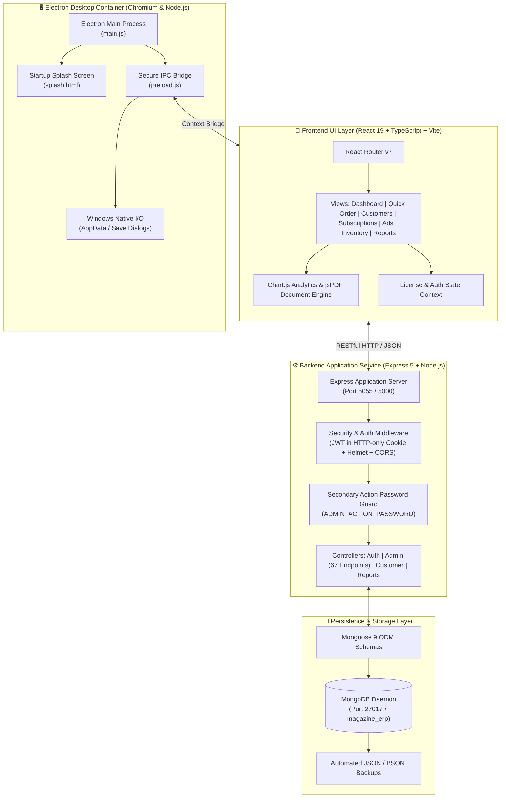
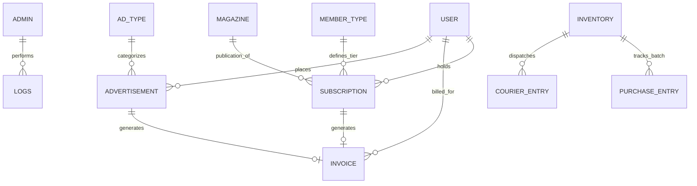

<div align="center">

  

  # 📚 Aachi Vanthachu (ஆச்சி வந்தாச்சு)
  ### Enterprise Magazine ERP & Subscription Lifecycle Management System

  <p align="center">
    A production-ready, full-stack <strong>Electron + React 19 + Express 5 + MongoDB</strong> desktop enterprise platform designed specifically for periodicals, print publications, and cultural magazines to streamline customer onboarding, recurring subscription lifecycles, advertisement booking, courier logistics, financial invoicing, and business analytics.
  </p>

  <p align="center">
    <a href="#-key-features"></a>
    <a href="#-technology-stack"></a>
    <a href="#-technology-stack"></a>
    <a href="#-technology-stack"></a>
    <a href="#-desktop-architecture--packaging"></a>
  </p>

  <p align="center">
    <a href="#-table-of-contents"><strong>Explore Documentation »</strong></a>
    <br />
    <a href="#-quick-start">Quick Start</a>
    ·
    <a href="#-system-architecture">Architecture</a>
    ·
    <a href="#-data-models--schema">Database Schema</a>
    ·
    <a href="#-default-credentials">Default Credentials</a>
    ·
    <a href="#-desktop-packaging--distribution">Build & Packaging</a>
  </p>

</div>

---

## 📑 Table of Contents

- [🎯 Problem Statement & Overview](#-problem-statement--overview)
- [✨ Key Features](#-key-features)
  - [1. Executive Analytics & BI Dashboard](#1-executive-analytics--bi-dashboard)
  - [2. Quick Order Engine](#2-quick-order-engine)
  - [3. Customer & Member Management](#3-customer--member-management)
  - [4. Subscription Lifecycle & Renewal Engine](#4-subscription-lifecycle--renewal-engine)
  - [5. Advertisement Campaign Billing](#5-advertisement-campaign-billing)
  - [6. Inventory & Courier Logistics](#6-inventory--courier-logistics)
  - [7. Invoicing & Document Generation](#7-invoicing--document-generation)
  - [8. Reports & Data Export](#8-reports--data-export)
  - [9. Database Backup, Restore & Administrative Safety](#9-database-backup-restore--administrative-safety)
  - [10. Hardware Licensing & Machine Activation](#10-hardware-licensing--machine-activation)
- [🏛 System Architecture](#-system-architecture)
- [🗄 Data Models & Schema](#-data-models--schema)
- [🛠 Technology Stack](#-technology-stack)
- [🚀 Quick Start](#-quick-start)
  - [Prerequisites](#prerequisites)
  - [1. Clone Repository](#1-clone-repository)
  - [2. Backend Setup](#2-backend-setup)
  - [3. Frontend Setup](#3-frontend-setup)
  - [4. Seed Initial Data](#4-seed-initial-data)
  - [5. Run the Application](#5-run-the-application)
- [📦 Desktop Packaging & Distribution](#-desktop-packaging--distribution)
- [🔑 Default Credentials & Environment Variables](#-default-credentials--environment-variables)
- [📂 Project Directory Layout](#-project-directory-layout)
- [🛡 Security & Operational Safeguards](#-security--operational-safeguards)
- [🧪 Technical Evaluation & Test Matrix](#-technical-evaluation--test-matrix)
- [📄 License & Credits](#-license--credits)

---

## 🎯 Problem Statement & Overview

Print publications and heritage periodicals like **Aachi Vanthachu** face distinct operational challenges that generic CRMs cannot address:
- **Disparate Records**: Customer addresses, multi-year subscription plans, advertisement insertions, inventory stock, and courier dispatch receipts frequently live in disconnected spreadsheets.
- **Renewal Leakage**: Manual expiry tracking causes missed renewal windows, delayed communication, and revenue loss.
- **Logistical Complexity**: Generating bulk postal dispatch labels, tracking regional deliveries across 38+ Tamil Nadu districts, and managing batch courier logs manually is error-prone.
- **Desktop Simplicity**: Back-office operational teams need a standalone, reliable desktop application that does not require manual web server configuration, browser bookmarks, or continuous cloud dependencies.

**Aachi Vanthachu ERP** solves this by bundling an **Express REST API**, a **React 19 single-page dashboard**, and a **Node runtime** inside an **Electron desktop container** with local MongoDB persistence, automated backup scheduling, one-click PDF generation, and Excel reporting.

---

## ✨ Key Features

### 1. Executive Analytics & BI Dashboard
- **Financial & Operational KPI Cards**: Real-time stats on Gross Revenue, Active Subscriptions, Expiring Subscriptions (30-day window), Total Customers, and Advertisement accounts.
- **Interactive Visualizations (Chart.js)**:
  - Monthly subscription revenue & trend trajectories.
  - Plan distribution (Annual vs. 3-Year vs. 5-Year vs. Life Membership).
  - Geographical heat distribution across districts and states.
- **Actionable Expiry Radar**: Instant alerts for subscriptions nearing expiration with direct 1-click renewal triggers.

### 2. Quick Order Engine
- **Point-of-Sale (POS) Workflow**: Rapid single-pane checkout for counter and phone-in orders.
- **Dynamic Price & Date Calculator**: Automatically computes start/expiry dates, applies duration multipliers, and factors in membership plan discounts.
- **Instant Dual Emission**: Concurrently writes subscriber profile, establishes active subscription, generates numbered invoice, and provides immediate PDF receipt preview.

### 3. Customer & Member Management
- **Categorized Profiles**: Specialized fields for *Subscription Customers*, *Advertisement Clients*, *Kovils (Temples)*, and *Nagarathaar Sangams*.
- **Comprehensive Geography**: Built-in master list of 38 Tamil Nadu districts and all Indian states with PIN code validation.
- **Delivery Mode Settings**: Tracks dispatch preferences (Courier, Hand Delivery, Post) and detailed recipient instructions.
- **Order History Audit**: Embedded timeline of every order, subscription history, payment transaction, and issued invoice per customer.

### 4. Subscription Lifecycle & Renewal Engine
- **Multi-Tier Duration Support**: Configure flexible membership tiers (Annual, 3-Year, 5-Year, 10-Year Life Membership).
- **Lifecycle States**: Real-time state determination: `Active`, `Expiring Soon`, `Expired`, `Renewed`.
- **Seamless Renewal Modal**: Extend subscription periods without re-entering customer information, retaining unique membership numbers.
- **Manual Date Overrides**: Administrative flexibility to adjust start and expiry dates with secondary action password authentication.

### 5. Advertisement Campaign Billing
- **Ad Inventory & Placement Specifications**: Classify ad types (*Full Page Color*, *Half Page*, *Quarter Page*, *Front/Back Cover*).
- **Client Linkage**: Associate ad campaigns with registered advertisers or standalone corporate entities.
- **Release Scheduling**: Track publication edition, issue volume, release dates, and publication status.
- **Financial Billing Integration**: Direct generation of commercial ad invoices with custom payment status tracking (Paid, Unpaid, Partial).

### 6. Inventory & Courier Logistics
- **Magazine Edition Tracking**: Master list of regular periodicals and special commemorative festival editions.
- **Stock Movement Ledger**: Log purchase entries, batch print runs, incoming stock, and current warehouse counts.
- **Courier & Dispatch Tracker**: Dedicated tracking number entry, dispatch partner records, recipient addresses, and delivery dates.

### 7. Invoicing & Document Generation
- **Client-Side Vector PDF Engine**: High-fidelity PDF generation via `jsPDF` and `jspdf-autotable`.
- **Branded Stationery Layout**: Native Tamil/English headers, company credentials, tax details, itemized breakdown, and terms.
- **Desktop Direct File I/O**: Electron IPC integration (`electronAPI.savePDF`) directly triggers native Windows file dialogs to save PDFs locally.

### 8. Reports & Data Export
- **Print-Ready Dispatch Sheets**: Formatted PDF printable labels for bulk monthly postal distribution.
- **Excel Spreadsheet Export**: One-click `.xlsx` export (via `SheetJS` / `ExcelJS`) for accountants, auditors, and management reviews.
- **Custom Filtering**: Slice data by date ranges, member types, districts, payment status, or dispatch mode.

### 9. Database Backup, Restore & Administrative Safety
- **Background Scheduled Backup**: Periodic automated database dumps saved directly to user-selected folders.
- **Safe Administrative Actions**: Critical operations (database reset, bulk deletion, manual date editing) require a secondary `ADMIN_ACTION_PASSWORD`.
- **Local Application Isolation**: User database, session logs, and runtime data are isolated in `%LOCALAPPDATA%\Aachi Vanthachu\`.

### 10. Hardware Licensing & Machine Activation
- **Machine Fingerprinting**: Cryptographic hardware ID generation via `node-machine-id`.
- **Activation Screen & Verification**: Onboarding gatekeeper supporting license key validation and local license caching (`LocalLicense`).

---

## 🏛 System Architecture

The following diagram details the unified architecture across the Electron desktop shell, frontend single-page application, Express backend service, and data layer:



---

## 🗄 Data Models & Schema

The system is powered by 12 normalized Mongoose models:



| Model | File | Core Purpose | Key Fields |
|:---|:---|:---|:---|
| **Admin** | [`Admin.js`](file:///server/models/Admin.js) | Administrator accounts and security locks | `username`, `password` (bcrypt), `actionPassword`, `role` |
| **User** | [`User.js`](file:///server/models/User.js) | Customers, subscribers, and advertisers | `name`, `phone`, `email`, `address`, `district`, `state`, `pincode`, `customerCategory`, `dispatchType` |
| **Subscription** | [`Subscription.js`](file:///server/models/Subscription.js) | Recurring magazine subscription plans | `userId`, `memberTypeId`, `magazineId`, `startDate`, `endDate`, `status`, `paymentMethod`, `amountPaid` |
| **MemberType** | [`MemberType.js`](file:///server/models/MemberType.js) | Subscription tier definitions | `name`, `durationInMonths`, `price`, `letter` (A, B, C, L), `description` |
| **Invoice** | [`Invoice.js`](file:///server/models/Invoice.js) | Financial billing records | `invoiceNumber`, `userId`, `subscriptionId`, `advertisementId`, `amount`, `status`, `paymentMethod`, `date` |
| **Advertisement** | [`Advertisement.js`](file:///server/models/Advertisement.js) | Commercial advertisement orders | `userId`, `adTypeId`, `releaseDate`, `size`, `colorType`, `amount`, `paymentStatus` |
| **AdType** | [`AdType.js`](file:///server/models/AdType.js) | Standardized advertisement formats | `name`, `description` |
| **Magazine** | [`Magazine.js`](file:///server/models/Magazine.js) | Master publication details | `title`, `description`, `price`, `category`, `periodicity` |
| **Inventory** | [`Inventory.js`](file:///server/models/Inventory.js) | Stock ledger for printed copies | `magazineId`, `edition`, `stockCount`, `unitPrice` |
| **PurchaseEntry** | [`PurchaseEntry.js`](file:///server/models/PurchaseEntry.js) | Printing and procurement expenses | `billNumber`, `vendorName`, `quantity`, `totalCost`, `purchaseDate` |
| **CourierEntry** | [`CourierEntry.js`](file:///server/models/CourierEntry.js) | Dispatch and courier tracking logs | `docketNumber`, `courierPartner`, `dispatchDate`, `recipientDetails`, `status` |
| **LocalLicense** | [`LocalLicense.js`](file:///server/models/LocalLicense.js) | Hardware-bound license verification | `key`, `clientName`, `plan`, `expiryDate`, `status`, `hardwareId`, `lastSynced` |

---

## 🛠 Technology Stack

### Frontend Application
- **Library/Framework**: [React 19.2.0](https://react.dev/) + [TypeScript 5.9](https://www.typescriptlang.org/)
- **Bundler & Dev Server**: [Vite 7.2.4](https://vitejs.dev/) with `@vitejs/plugin-react`
- **Routing**: [React Router v7](https://reactrouter.com/)
- **Charts & Data Visualization**: [Chart.js 4.5.1](https://www.chartjs.org/) + `react-chartjs-2`
- **Document & Spreadsheet Generation**: [jsPDF 3.0.4](https://github.com/parallax/jsPDF), `jspdf-autotable 5.0.2`, [XLSX (SheetJS)](https://sheetjs.com/)
- **Icons & Styling**: `react-icons 5.5.0` + Custom scoped CSS Design System

### Backend & API Service
- **Runtime**: [Node.js (v18+ LTS)](https://nodejs.org/)
- **Web Framework**: [Express 5.2.1](https://expressjs.com/)
- **Database ODM**: [Mongoose 9.0.2](https://mongoosejs.com/)
- **Security & Cryptography**: `bcryptjs 3.0.3`, `jsonwebtoken 9.0.3`, `helmet 8.1.0`, `cors 2.8.5`, `cookie-parser 1.4.7`
- **File & Spreadsheet Processing**: `multer 2.0.2`, `exceljs 4.4.0`

### Desktop Application Layer
- **Desktop Framework**: [Electron 33.2.1](https://www.electronjs.org/)
- **Packaging & Distributables**: [electron-builder 25.1.8](https://www.electron-build.er/) + `electron-packager 17.1.2`
- **Hardware Telemetry**: `node-machine-id 1.1.12`
- **Process Orchestration**: `tree-kill 1.2.2`, Node `child_process` (fork/spawn)

---

## 🚀 Quick Start

### Prerequisites
Ensure your workstation has the following installed:
- [Node.js](https://nodejs.org/) (Version `18.x` or higher)
- [MongoDB Community Server](https://www.mongodb.com/try/download/community) running locally on port `27017`
- [Git](https://git-scm.com/)

---

### 1. Clone Repository
```bash
git clone https://github.com/varun-8/Subscription-based-model.git
cd Subscription-based-model
```

### 2. Backend Setup
```bash
cd server
npm install
```
Verify or customize the environment variables in `server/.env`:
```env
MONGODB_URI=mongodb://127.0.0.1:27017/magazine_erp
JWT_SECRET=9f3c6f8c97e4a2d1b5f0e9c7a4b2d8f61c0e7a9b3f4d2e8c6a5b9d1f7e0c4a2
PORT=5000
ADMIN_ACTION_PASSWORD=AACHI@123
DB_RESET_PASSWORD=AACHI@123
```

### 3. Frontend Setup
```bash
cd ../client
npm install
```

### 4. Seed Initial Data
Populate the database with default administrator credentials, subscription plans, magazines, and sample records:
```bash
# From workspace root
npm run seed
# Or directly from server folder
cd server && npm run seed
```

### 5. Run the Application

#### Option A: Run Full Desktop Electron Application (Recommended)
This starts Electron, launches the background Express backend, checks MongoDB connectivity, displays the splash screen, and opens the main window:
```bash
# From workspace root
npm start
```

#### Option B: Run in Web Development Mode
For quick frontend/backend development with Hot Module Replacement (HMR):
```bash
# Terminal 1: Start Express API
cd server
npm run dev

# Terminal 2: Start React Vite Dev Server
cd client
npm run dev
```
Open [http://localhost:5173](http://localhost:5173) in your browser.

---

## 📦 Desktop Packaging & Distribution

The desktop application can be built into standalone Windows executables using predefined npm scripts in the root `package.json`:

| Command | Output Target | Description |
|:---|:---|:---|
| `npm run dist` | `release/` | Builds both NSIS Installer (`.exe`) and Portable standalone (`.exe`) |
| `npm run dist:installer` | `release/` | Builds Windows NSIS setup wizard with desktop shortcuts and uninstaller |
| `npm run dist:portable` | `release/` | Builds single self-contained portable executable (no install required) |
| `npm run package:win` | `dist-packager/` | Generates unpacked standalone Windows distribution folder via `electron-packager` |

> [!TIP]
> The build script automatically executes `build:client` to compile the Vite TypeScript assets into `client/dist`, which is then packaged as extra resources alongside the backend server.

---

## 🔑 Default Credentials & Environment Variables

### Initial Access Credentials (Created via Seeder)

| Role | Username | Password | Secondary Action Password | Access Level |
|:---|:---|:---|:---|:---|
| **Super Admin** | `admin` | `password123` | `AACHI@123` | Full dashboard, database backup/reset, editing dates, system settings |

### Configuration Variables Reference

| Variable Name | Default Value | Description |
|:---|:---|:---|
| `PORT` / `SERVER_PORT` | `5055` (Electron) / `5000` (Server) | Port on which the local Express server listens |
| `MONGODB_URI` | `mongodb://127.0.0.1:27017/magazine_erp` | Connection URI for the MongoDB database |
| `JWT_SECRET` | *(64-character hex key)* | Secret key used to sign and verify session JWTs |
| `ADMIN_ACTION_PASSWORD` | `AACHI@123` | Passcode required for high-risk actions (modifications, resets) |
| `DB_RESET_PASSWORD` | `AACHI@123` | Passcode required to purge and rebuild local database |

---

## 📂 Project Directory Layout

```text
Subscription-based-model/
├── client/                     # Frontend Application (React 19 + TypeScript + Vite)
│   ├── src/
│   │   ├── assets/             # Branding logos, icons, and static graphics
│   │   ├── components/
│   │   │   └── admin/          # 42 Modular Admin Views, Modals & Forms
│   │   │       ├── AnalyticsView.tsx        # BI charts, revenue & renewal stats
│   │   │       ├── QuickOrderView.tsx       # Rapid POS ordering engine
│   │   │       ├── CustomersView.tsx        # Customer table, search & filters
│   │   │       ├── SubscriptionsView.tsx    # Subscription lifecycle management
│   │   │       ├── AdvertisementsView.tsx   # Ad campaign scheduling & billing
│   │   │       ├── InvoicesView.tsx         # Invoice generation & PDF preview
│   │   │       ├── InventoryView.tsx        # Stock tracking & courier entries
│   │   │       ├── ReportsView.tsx          # Export reports (Excel/PDF)
│   │   │       ├── DatabaseView.tsx         # Backups, restore & DB reset
│   │   │       └── ...                      # Context modals, security prompts
│   │   ├── context/            # License and global React state contexts
│   │   ├── constants.ts        # Master lists (38 Tamil Nadu Districts, Indian States)
│   │   ├── Admin.tsx           # Primary Admin routing container
│   │   ├── Customer.tsx        # Customer self-service magazine catalog
│   │   ├── Login.tsx           # Authenticated entry with DB health monitor
│   │   └── index.css           # Design tokens, variables & typography
│   └── package.json            # Client package dependencies
│
├── electron/                   # Desktop Shell Layer
│   ├── main.js                 # Electron process lifecycle, IPC & process manager
│   ├── preload.js              # Safe contextBridge IPC exposed APIs
│   ├── splash.html             # High-aesthetic startup splash screen
│   └── logo.png                # Desktop icon and branding asset
│
├── server/                     # Backend Application Service
│   ├── models/                 # 12 Mongoose ODM Schema Definitions
│   │   ├── Admin.js            # Admin credentials & action secrets
│   │   ├── User.js             # Customer & subscriber master profiles
│   │   ├── Subscription.js     # Subscription terms & active validity
│   │   ├── Invoice.js          # Invoices & billing receipts
│   │   ├── Advertisement.js    # Advertisement booking entries
│   │   ├── Inventory.js        # Printed issue stocks
│   │   ├── CourierEntry.js     # Dispatch tracking logs
│   │   └── ...                 # MemberType, Magazine, AdType, LocalLicense
│   ├── routes/
│   │   ├── admin.js            # 67 REST endpoints for complete ERP operations
│   │   ├── auth.js             # Authentication, session check & admin creation
│   │   └── customer.js         # Customer catalog & self-subscription endpoints
│   ├── index.js                # Express bootstrapping, DB retry loop, static serving
│   ├── seed_sample_data.js     # Comprehensive seeder script with test data
│   └── package.json            # Server dependencies
│
├── package.json                # Root desktop build scripts & electron-builder config
└── README.md                   # Project documentation & reference manual
```

---

## 🛡 Security & Operational Safeguards

- **HTTP-Only Cookie Sessions**: Authentication tokens (`token`) are delivered via HTTP-only cookies, safeguarding against cross-site scripting (XSS) extraction.
- **Two-Factor Action Password Gate**: Critical operations (e.g. database purge, manual subscription date extension, bulk customer removal) require entering the secondary `ADMIN_ACTION_PASSWORD`.
- **Database Self-Healing Reconnect Loop**: If MongoDB is restarted or temporarily unreachable, the backend maintains an automatic non-blocking retry loop every 3,000ms.
- **Local Sandbox Execution**: Desktop runtime caches, temporary PDF artifacts, and user data are strictly isolated inside standard Windows LocalAppData folders.

---

## 🧪 Technical Evaluation & Test Matrix

Below is a representative verification checklist demonstrating the operational validity of the system:

| Test ID | Scenario | Expected Behavior | Status |
|:---|:---|:---|:---:|
| `TC-001` | **Admin Authentication** | Valid credentials allow access to full Admin Dashboard | `PASS` ✅ |
| `TC-002` | **Initial Admin Creation** | Prompts for initial admin registration with `ADMIN_ACTION_PASSWORD` | `PASS` ✅ |
| `TC-003` | **Quick Order Execution** | Concurrently creates User, Subscription, and numbered Invoice | `PASS` ✅ |
| `TC-004` | **Client-Side PDF Generation** | Produces branded printable invoice and triggers native save | `PASS` ✅ |
| `TC-005` | **Excel Dispatch Export** | Exports formatted `.xlsx` containing filtered subscriber records | `PASS` ✅ |
| `TC-006` | **Automated Local Backup** | Generates timestamped database dump to chosen local folder | `PASS` ✅ |
| `TC-007` | **Database Reconnection** | Server gracefully recovers when MongoDB daemon resumes | `PASS` ✅ |
| `TC-008` | **Action Password Rejection** | Rejects sensitive edits when incorrect action password is submitted | `PASS` ✅ |

---

## 📄 License & Credits

- **Project**: Aachi Vanthachu (ஆச்சி வந்தாச்சு) — Magazine ERP Desktop
- **Developer / Organization**: MagAdmin & Development Team
- **License**: ISC License

<div align="center">
  <sub>Built with ❤️ for preserving cultural publications and streamlining magazine operations.</sub>
</div>
